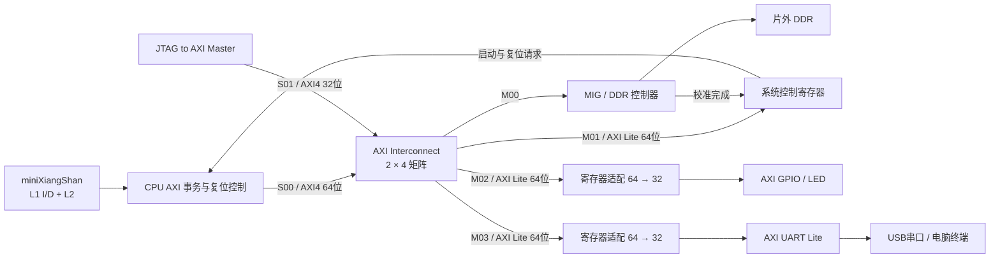

# 第一版 CPU SoC

本版目标是建立 miniXiangShan 的 FPGA 裸机平台：JTAG 下载程序到 DDR，CPU 启动后
通过 UART 输出文本、接收字符，并控制 LED。互联使用 Vivado AXI Interconnect 的
2 主、4 从矩阵结构。加速器后续作为新的控制从设备和访存主设备接入。

已提供集成 RTL、Tcl 工程生成流程和裸机程序。具体板卡尚未选定，因此当前没有
可直接烧录的 bitstream，也没有完成 Vivado 综合、实现或上板验证。

## 数据通路

CPU 外部地址/数据各 64 位，ID 4 位，缓存行 64 字节；JTAG 主设备使用 32 位地址和
数据。首版逻辑地址限制在 4 GiB 内，DDR 从 `0x80000000` 开始，容量由板卡决定，
最大映射 2 GiB。DDR 是可缓存区域；设备位于 CPU 已有的不可缓存窗口。

UART 在电脑终端显示文本。它不包含 LCD、HDMI、帧缓冲或显示控制器。
首版采用轮询，CPU 中断输入接零，UART 中断输出暂不接入；定时器、PLIC、操作系统
启动和 RISC-V 原子扩展的系统支持留待后续建设。

## 地址与访问约定

地址的唯一维护位置是 `hardware/soc/config/base.json`。`make soc-config` 生成
`build/soc/` 中的 Tcl、C 头文件和 Verilog 宏；RTL、软件和 JTAG 使用这些定义。
完整寄存器表见 [地址映射](../interfaces/memory-map.md)。

CPU 当前对不可缓存区域同样发出 `AxSIZE=3` 的 8 字节事务。直接通过标准
64→32 位 downsizer 连接 UART，可能把一次读取拆成两次，对 FIFO 产生额外副作用。
本版在 GPIO/UART 前放置 `hision_mmio32`：

- CPU/JTAG 逻辑寄存器间隔为 **8 字节**，原生 IP 寄存器间隔仍为 4 字节。
- 一次逻辑访问对应一次原生 32 位访问，读取结果高 32 位补零。
- 软件统一使用 32 位读写；地址必须按 8 字节对齐。写选通必须为 `0x0f`。
- 字节、半字、高 32 位或整 64 位写入，以及越过已定义寄存器范围的访问返回 SLVERR。
- GPIO 配置为全输出。驱动按板卡极性转换“点亮掩码”，写入完整 32 位。

例如 UART TX 的 CPU 地址为 `0x40020008`，原生 IP 偏移为 `0x04`；UART STATUS 的
CPU 地址为 `0x40020010`，原生偏移为 `0x08`。不能直接使用默认 UART Lite 驱动的偏移。

## 时钟与复位

首版只使用一个 AXI 时钟域：DDR 控制器的 UI 时钟，同时驱动 CPU、JTAG AXI、矩阵、
系统控制和外设。实际频率由 MIG/板卡方案决定；`target.tcl` 中的 `axi_clock_hz`
必须与实际 UI 时钟一致，脚本会比对时钟元数据。CPU 的可达频率和资源占用需综合、
布局布线后确定；若 UI 时钟过高，应在板卡适配中增加独立 CPU 时钟域和 AXI CDC。

板卡 memory provider 负责 DDR 物理接口、输入时钟、外部复位、UI 复位同步及 AXI 复位。
提供的 7 系列适配使用 MIG `ui_clk_sync_rst` 驱动 Processor System Reset，产生同域
`peripheral_aresetn`。DDR 校准完成只控制 CPU 启动；总线和外设可以先释放，便于观察。
如果 UI 时钟尚未运行或复位未释放，JTAG AXI 也无法完成访问。

系统复位后，`RUN=0`，CPU 保持复位。系统控制和 JTAG 的复位独立于 CPU 启动控制。
`RUN=1` 且 DDR 校准完成时，同步释放 CPU 复位。

`RUN=0` 会阻止选择新的 CPU 外部 AXI 事务；已选中的事务继续到读末拍或写响应握手后，
再复位 CPU。即使 AW、W 分开到达，也不会中途丢弃已对外呈现的 VALID。
如果从设备不响应，复位请求会等待，可从 STATUS 观察 `bus_busy`。
恢复方式是检查总线/DDR并执行板卡级复位。

这是重新启动：CPU 内部缓存、队列中的数据可能被丢弃。它不保存程序现场，也不将脏
缓存自动写回 DDR。JTAG 下载/修改程序必须先等待 CPU 进入复位，然后重新启动。
JTAG 读取运行中程序的数据时不保证缓存一致性。DDR 校准丢失时，板卡适配必须使整个
AXI 系统重新复位，避免只复位 CPU 而遗留未完成事务。

## 下载与启动

1. FPGA 配置 bitstream，系统控制保持 CPU 复位。
2. Hardware Manager 连接 JTAG AXI，读取 SoC ID、状态。
3. 等待 DDR 校准完成，将 BIN 下载到 DDR 起始地址，逐字读回核对。
4. 设置 `RUN=1`，CPU 从 `0x80000000` 执行 `_start`。
5. 程序初始化 BSS、栈和 UART，终端显示欢迎信息，LED0 闪烁，串口回显。

第一版不需要 Boot ROM，但依赖主机完成下载。掉电后程序丢失。独立上电启动应另加
ROM、Flash/SD 装载器和镜像格式。本版 JTAG 是总线访问设备，不提供 GDB、单步、
寄存器访问、断点或 RISC-V Debug Module。

## CPU RAM

`soc` 模式关闭差分接口和行为 RAM，保留 CPU RAM 黑盒；Tcl 从生成 RTL 自动提取
RAM 模块名、深度和位宽，生成可推断 BRAM 的 Verilog。L1/BPU 读取一拍，L2 读取两拍。
不沿用旧工程固定的 tag 位宽。RAM 上电初始化为零，CPU 复位重置 L1/BPU 的有效位并
触发 L2 metadata scrub；不通过清空整个 RAM 实现复位。

实际 BRAM 推断、容量、读写碰撞约束及布局效果仍需 Vivado 报告确认。未来 CPU 升级若
改变 RAM 接口或延迟，需同步更新适配。AXI 错误在系统控制中记录粘滞状态，但当前核
未将所有 AXI 错误转为完整的架构访存异常。

## 后续加速器接入

新加速器控制端口接矩阵的新 M 接口，DMA 接新的 S 接口；先明确缓冲区所有权与
缓存维护协议。矩阵允许不同目标并行访问，同一 DDR 端口仍需要仲裁。
当前不为尚未实现的加速器分配地址、带宽或板卡资源。

## 参考

- [AMD AXI Interconnect PG059](https://docs.amd.com/r/en-US/pg059-axi-interconnect/Features)
- [PG059：AXI Downsizer](https://docs.amd.com/r/en-US/pg059-axi-interconnect/AXI-Downsizer)
- [AMD AXI GPIO：寄存器](https://docs.amd.com/r/en-US/pg144-axi-gpio/Register-Space)
- [AMD AXI UART Lite PG142](https://docs.amd.com/api/khub/documents/dB1MAeh~uLG7FE62a5_QbA/content)
- [AMD MIG 7 系列 UI](https://docs.amd.com/r/en-US/ug586_7Series_MIS/User-Interface)
- [AMD Hardware Manager AXI 事务](https://docs.amd.com/r/2024.1-English/ug835-vivado-tcl-commands/create_hw_axi_txn)
