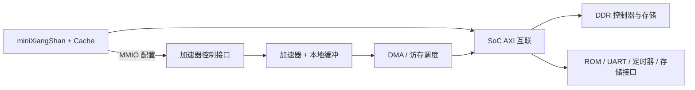

# 系统架构

## 当前可运行部分

主仓库通过 `build.sbt` 编译 CPU 子模块与自有平台生成入口。
`emu` 模式生成 `core_top`，由 CPU 仓库的 C++ 驱动提供内存、简化 MMIO、终止协议和
NEMU 差分接入。该平台是 CPU 基线，尚无加速器或真实外设。

`compare` 模式选择 CPU 仓库的 `MiniPerfTop`，连接 CPU 基线实验的 AXI4 性能模型。
`fpga` 模式生成带 CPU 仓库 RAM 黑盒的核 RTL，仍需板卡适配和实际 IP。

## 目标系统（规划）

控制路径负责描述任务、启动与完成通知；数据路径负责批量读取、计算与写回。
共享缓冲的数据所有权和可见性通过明确协议处理。

`hardware/accelerators/` 负责计算，`hardware/memory/` 负责搬运与调度，
`hardware/soc/` 负责连接，`software/drivers/` 负责软件访问。
任务与实验配置在 `software/apps/` 和 `experiments/` 维护。

架构图表示建设目标，具体实现状态以 [status.md](../status.md) 为准。
